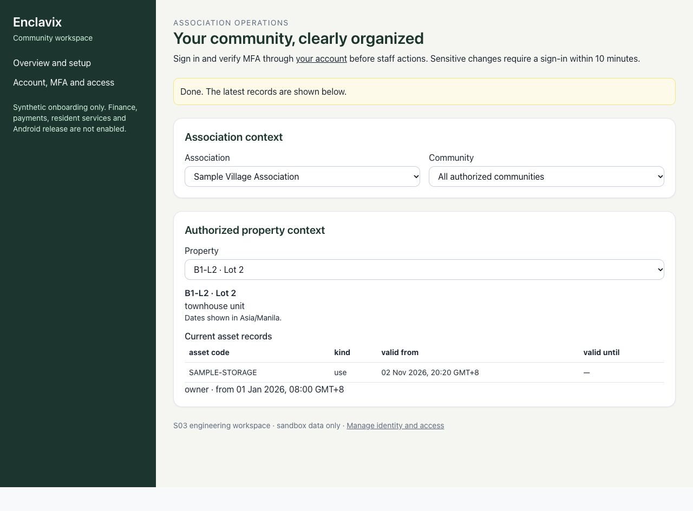
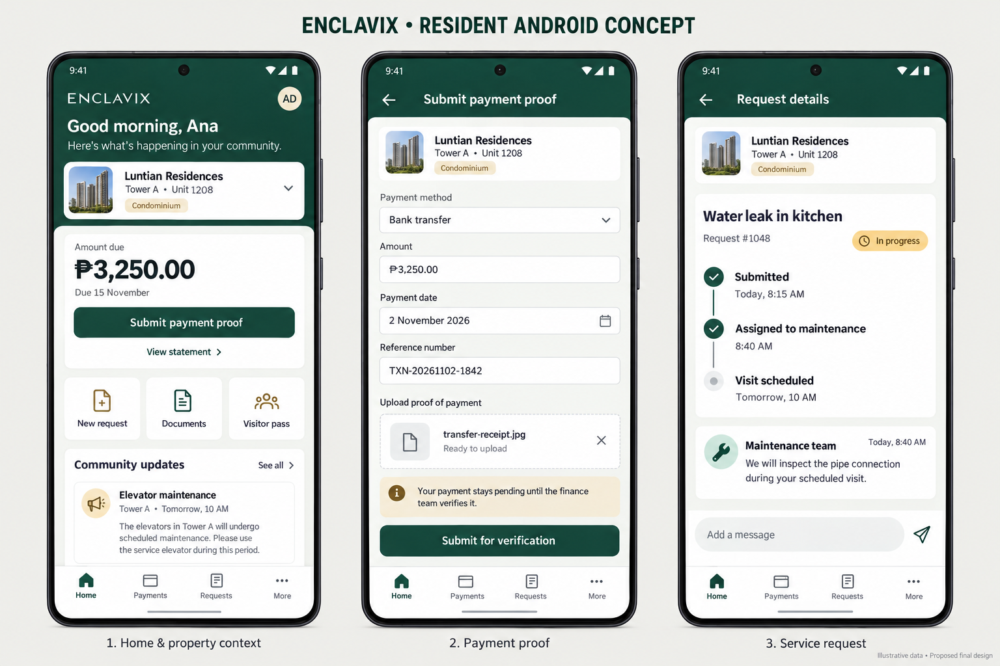

# Enclavix — HOA & Enclave Operating System

Enclavix is being rebuilt as a multi-tenant community platform with a responsive web front end and a planned post-S11 commercial Android app for independent village and condominium associations.

**Current state: a contained development platform with S00–S03 engineering scope accepted. It is not approved for real resident data, financial operations or gate decisions.**

## Delivery status

Accepted engineering delivery baseline as of 2 November 2026:

| Sprint | Status | Delivered scope |
| --- | --- | --- |
| [S00](docs/delivery/evidence/S00.md) | Accepted — [PR #1](https://github.com/jgotangco/enclavix/pull/1) | Reproducible builds, mock-demo isolation, closed production portals and default-deny prototype tables |
| [S01](docs/delivery/evidence/S01.md) | Accepted — [PR #2](https://github.com/jgotangco/enclavix/pull/2) | Private tenant domain, scoped relationships, generated types, fixtures, isolation/concurrency checks and architecture contracts |
| [S02](docs/delivery/evidence/S02.md) | Accepted — [PR #3](https://github.com/jgotangco/enclavix/pull/3) | Verified identity, MFA, scoped account services, invitations/approval, revocation and private download authorization |
| [S03](docs/delivery/evidence/S03.md) | Accepted — [PR #4](https://github.com/jgotangco/enclavix/pull/4), [PR #6](https://github.com/jgotangco/enclavix/pull/6) | Synthetic onboarding, property/asset relationships, import reconciliation and export/offboarding staging |
| S04–S05, S08–S11 | Not started | Web finance, resident/guard operations, hardening and pilot acceptance |
| S06–S07 | Deferred — not started | Commercial Android after S11 acceptance and pilot evidence |

S03 was reviewed and accepted by Jerome Gotangco on 2 November 2026. S04 (receivables and payment verification) is planned for 3 November 2026, Asia/Manila, and has not started.

[STATUS.json](docs/delivery/STATUS.json) is the delivery-state record. Sprint acceptance does not certify production readiness or approve unresolved hosting and mobile decisions. No production deployment or hosted migration has been performed.

## Implemented foundation and planned product

The current private PostgreSQL `app` schema contains 26 tables. S01 established the tenant domain; S02–S03 added identity/access controls, onboarding approval, registry operations and export/offboarding staging. Village phase/block and condominium tower/floor structures, people, properties, assets and effective-dated relationships share scoped identities. Composite foreign keys reject cross-association references. Ordinary clients have no direct table access; named services enforce authorization, and the schema is not exposed through the Data API.

The existing web screens demonstrate resident, administration, finance and guard experiences using synthetic data. Demo sign-in does not verify a real password. The client-controlled `demo_user_role` cookie selects a mock persona only in explicitly configured mock-demo mode; it cannot authorize production access. Legacy mock business portals remain unavailable in production; the delivered account and registry journeys use trusted services. S02 adds real server-side authentication through `/account` and `/api/v1`; direct browser backend access remains disabled.

Dues and payment verification, documents, visitors, parking, pets and amenities remain planned durable workflows. Prototype buttons and screens are not evidence of successful financial or gate operations. The Android app is not implemented. Kotlin/Compose and React Native are compared in the [Android ADR](docs/architecture/adr/0003-android-platform.md); the final choice is pending approval and a device spike.

## Interface previews

**Implemented web workspace — accepted S03 scope, synthetic review data.** Residents see their currently authorized property/asset records; administrators have separate registry and onboarding controls. This is an actual built-web screenshot, not a production deployment.



The [onboarding review screenshot](docs/delivery/evidence/assets/S03-onboarding-sandbox.jpg) shows completed synthetic setup and independent sandbox activation. Browser review used a disposable local Auth stand-in for screen behavior; real Auth/MFA and authorization were verified separately in Supabase CI. See [S03 evidence](docs/delivery/evidence/S03.md).

**Planned Android interface — illustrative concept only, not implemented.** This mockup shows possible future resident home, payment-proof and request screens. Names, amounts and community details are fictional examples, not a selected pilot. The layout is a design direction, not an approved feature release or evidence of working mobile services. Commercial Android remains after S11 acceptance and pilot evidence; stack, distribution and license decisions remain separate.



## Local setup

Use Node.js 24 (see `.nvmrc`) and npm with the committed lockfile. Python 3.9+ runs the delivery checks. Docker is required only for local Supabase and container verification.

```bash
git clone https://github.com/jgotangco/enclavix.git
cd enclavix
npm ci
cp .env.example .env.local
npm run dev
```

Open [localhost:3000](http://localhost:3000). The example config enables the mock-only demo:

```env
ENCLAVIX_APP_ENV=demo
NEXT_PUBLIC_APP_ENV=demo
```

Do not add Supabase URL or key values in demo mode; even partial backend configuration causes build/startup rejection. Use only synthetic data. Demo edits are page-local and are not durable transactions.

For an optimized local demo build, keep the same configuration:

```bash
npm run build
npm start
```

See [development setup and containment](docs/development.md) for the separate contained-production preview and disposable local database checks. Cloud Build builds an image only; it does not deploy. Supabase and Cloud Run remain architecture candidates, with hosting region, tier and recovery commitments unresolved.

## Account and authorization foundation

S02 introduces email-verified accounts, association-approved applications, email-bound invitations, MFA for all staff roles, session inventory/sign-out, audited role changes and time-limited metadata-only support access. A civic title or demo cookie grants no production permission. Signed-out, revoked or wrong-association requests fail at trusted service/database boundaries.

The account area uses real services when configured in production mode. S03 adds the `/workspace` web journey and `/api/v1/community` shared services for synthetic association setup, independent activation, community/property/contact registries, effective relationships, imports, and export/offboarding staging. The current private schema has 26 tables. Finance, full offboarding, attachments, real-data onboarding and Android remain later work. See the [onboarding contract](docs/architecture/adr/0006-onboarding-and-registry.md). See the [identity contract](docs/architecture/adr/0005-identity-and-access.md) and [security runbook](docs/security-and-access.md).

## Verification

```bash
npm run lint
npm run types:check
npm run typecheck
npm test
python3 tests/s00_foundation.py
python3 tools/validate_delivery.py
python3 tools/test_validate_delivery.py
npm run build
node tools/check-http.mjs
```

The HTTP check uses the same environment mode as the build. `npm test` currently runs 80 checks, including forged-cookie containment, scoped foreign keys, rollback, immutable identities, document paths, asset allocation/retry controls, community date presentation and default-deny access. After changing migrations, regenerate transport types with `npm run types:domain` and commit the result.

GitHub Actions verifies production and demo web builds/runtime, a container build/runtime and disposable Supabase. The database job verifies real Auth sign-in and TOTP MFA, recovery, logout/revocation, built-web cookie and native bearer requests, private storage restrictions, migration/type agreement, restricted-role access and concurrent commands. These checks use synthetic fixtures and do not deploy or certify real-world HOA readiness. See the [S03 evidence](docs/delivery/evidence/S03.md) and earlier sprint evidence for results and limitations.

## Documentation

- [Start here](docs/START_HERE.md): current implementation boundaries and reading order.
- [Business requirements](docs/BRD.md): web and Android product outcomes for villages and condominiums.
- [Sprint roadmap](docs/delivery/SPRINTS.md), [traceability](docs/delivery/TRACEABILITY.md) and [acceptance gates](docs/delivery/ACCEPTANCE.md).
- [Architecture](docs/architecture/README.md): domain model, API compatibility, private storage, workers and decision records.
- [Open decisions](docs/delivery/DECISIONS.md): accountable owners and pending approvals.
- [Repository instructions](AGENTS.md) and [optional Antigravity handoff](docs/antigravity/MASTER_PROMPT.md).

The historical [design specification](docs/ENCLAVIX_SDD.md) and [persona manual](docs/PERSONA_OPERATIONS_MANUAL.md) describe the prototype; they are not current operating procedures or production acceptance evidence.

## Credits and license

Product direction and design: [Jerome Gotangco](https://github.com/jgotangco). The original prototype was developed with Google Antigravity / Gemini; the S00–S03 refresh was implemented and reviewed with Codex.

Copyright © 2026 Jerome Gotangco. Enclavix is licensed under the [MIT License](LICENSE), including permission for commercial use, modification and distribution subject to its notice requirements. Third-party dependencies retain their respective licenses.

Approved delivery sequence: S00–S05 → S08 → S09 → S10 → S11 → S06 → S07. Android/iOS are not required for the initial pilot or first commercial web release. See [post-S11 candidates](docs/delivery/POST_S11.md); the core web remains MIT and future mobile licensing requires a separate decision.
