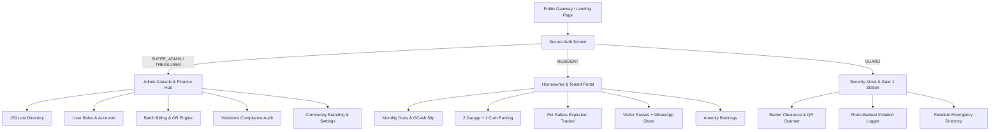

# HOA Management System — Persona & Operations Manual
**Enclave Edition: 150 Planned Residential Lots**  
**Version:** 2.0.0 Production  
**Lead Architect & Developer:** [Jerome Gotangco](https://github.com/jgotangco)  
**Repository:** [https://github.com/jgotangco/enclavix](https://github.com/jgotangco/enclavix)  
**Classification:** Official HOA Standard Operating Procedure (SOP)

---

## Table of Contents
1. [System Overview & Architecture](#1-system-overview--architecture)
2. [Persona 1: Super Admin (HOA President / Estate Manager)](#2-persona-1-super-admin-hoa-president--estate-manager)
3. [Persona 2: HOA Treasurer (Finance & Billing Officer)](#3-persona-2-hoa-treasurer-finance--billing-officer)
4. [Persona 3: Resident (Homeowner & Verified Tenant)](#4-persona-3-resident-homeowner--verified-tenant)
5. [Persona 4: Security Guard (Gate 1 Kiosk Personnel)](#5-persona-4-security-guard-gate-1-kiosk-personnel)
6. [Role-Based Access Control (RBAC) Matrix](#6-role-based-access-control-rbac-matrix)
7. [Default Seed Credentials for Housekeeping](#7-default-seed-credentials-for-housekeeping)

---

## 1. System Overview & Architecture

The **HOA Management System** is a unified digital governance platform engineered for boutique gated residential enclaves (150 lots) situated within larger mother subdivisions.

---

## 2. Persona 1: Super Admin (HOA President / Estate Manager)

### Role Summary
The **Super Admin** exercises complete executive, operational, and architectural control over the enclave. This role oversees property lot parameters, user role promotions, security citations, facility reservations, community advisories, and global branding.

### Primary Credentials (Production Default)
- **Email:** `admin@enclavehoa.com`
- **Default Password:** `Password123!`
- **Designated Route:** `/admin`

### Key Responsibilities & Daily Workflows
1. **User Accounts & Role Permissions Management (`/admin/users`):**
   - Review all registered homeowners, tenants, officers, and security personnel.
   - **In-Place Role Changer:** Promote any resident to `TREASURER` or `SUPER_ADMIN`, switch occupancy between `OWNER` and `TENANT`, or assign unit lots (`Block X Lot Y`).
   - Trigger password reset links and manage account activation/suspension.
2. **150 Lots Master Directory (`/admin/properties`):**
   - Search across Blocks 1 through 8.
   - Monitor lot areas ($180\text{ m}^2 - 280\text{ m}^2$), floor plans, and occupancy status (`OWNER_OCCUPIED`, `TENANTED`, `VACANT_LOT`).
   - Update lot-specific parameters and architectural notes.
3. **Security Citations & Violations Audit (`/admin/violations`):**
   - Inspect photographic evidence submitted by on-duty guards for parking violations and uncollected pet waste.
   - Confirm or dismiss citations, assess standard ₱500 fines that automatically aggregate into the unit's next monthly billing statement.
4. **Amenity Reservations Approval (`/admin/amenities`):**
   - Review booking applications for the Clubhouse Function Room, Swimming Pool Deck, Garden Pavilion, and BBQ Area.
   - Approve or decline requests with custom administrative remarks.
5. **Community Bulletin Announcements (`/admin/announcements`):**
   - Publish advisories with priority tags (`URGENT`, `HIGH`, `NORMAL`) and pin critical circulars to the top of all resident feeds.
6. **Community Branding & Settings (`/admin/settings`):**
   - Customize Enclave Village Name, Mother Subdivision Name, address, and emergency hotlines.
   - Adjust default dues formulas and switch active persona UI themes.

---

## 3. Persona 2: HOA Treasurer (Finance & Billing Officer)

### Role Summary
The **HOA Treasurer** oversees the enclave's financial health, dues assessments, collection verification, official receipt issuance, and late payment penalties.

### Primary Credentials (Production Default)
- **Email:** `treasurer@enclavehoa.com`
- **Default Password:** `Password123!`
- **Designated Route:** `/admin/billing`

### Key Responsibilities & Financial Workflows
1. **Variable Area-Based Dues Computation:**
   The billing engine calculates each unit's statement using the approved formula:
   $$\text{Total Statement} = (\text{Lot Area } m^2 \times \text{Rate/m}^2) + \text{Base Upkeep Fee} + \text{Mother Village Passthrough} + \text{Violation Fines} + \text{Special Assessments}$$
   - *Example (Block 2 Lot 1, 260 m²):* $(260 \times ₱25) + ₱500 + ₱300 + ₱0 = ₱7,300.00$
2. **1-Click Batch Monthly Invoicing:**
   - Generate invoices simultaneously for all **150 lots** for any specified billing period (e.g. `2026-10`).
   - Automatically pull unpaid violation fines into the unit's monthly balance.
3. **Payment Verification & Proof of Payment Audit:**
   - Inspect resident-uploaded GCash transaction receipts and bank deposit slips.
   - Compare reference numbers and paid amounts.
4. **Official Receipt (OR) Generation:**
   - 1-Click approval that transitions invoice status from `PENDING_VERIFICATION` to `PAID` and assigns a sequential Official Receipt number (`OR-2026-XXXX`).

---

## 4. Persona 3: Resident (Homeowner & Verified Tenant)

### Role Summary
The **Resident** is the primary end-user residing within the enclave. This persona manages their household statements, vehicle parking quotas, pet rabies certifications, visitor gate clearances, and amenity bookings.

### Primary Credentials (Production Default)
- **Email:** `resident@enclavehoa.com` (Juan Dela Cruz, Block 2 Lot 1)
- **Default Password:** `Password123!`
- **Designated Route:** `/resident`

### Key Features & Daily Workflows
1. **My Home Dashboard (`/resident`):**
   - Real-time balance summary, active vehicle permits, and rabies validity counters.
2. **Statements & Dues (`/resident/billing`):**
   - Itemized dues breakdown showing exact $m^2$ calculation.
   - GCash QR payment drawer with reference number submission and slip screenshot uploader.
   - Instant printable view of Official Receipts (`OR-2026-XXXX`).
3. **Vehicle & Parking Registry (`/resident/vehicles`):**
   - Register up to 2 vehicles in garage bays.
   - Allocate the strict **1-vehicle Carport Curb Parallel quota** (elevated parallel directly above carport curb without obstructing roads).
4. **Domestic Pet & Rabies Tracking (`/resident/pets`):**
   - Register domestic dogs and cats.
   - Upload veterinary anti-rabies vaccination cards with automatic **30-day expiration alerts**.
5. **Dual-Gate Visitor Passes (`/resident/visitors`):**
   - Generate 6-digit access codes (`MR-XXXX`) and QR passes valid for specific dates.
   - **1-Click Share:** Instant links to send access codes via **WhatsApp**, **Viber**, or **SMS** directly to incoming guests.
6. **Book Amenities (`/resident/amenities`):**
   - Browse facility cards with capacity, rental fees, and refundable security deposits.
   - Submit reservation requests for family events.
7. **Helpdesk Service Requests (`/resident/tickets`):**
   - Submit maintenance tickets and complaints with photo attachments.

---

## 5. Persona 4: Security Guard (Gate 1 Kiosk Personnel)

### Role Summary
The **Security Guard** operates the touch-screen Gate 1 security kiosk, verifying incoming vehicles and visitors across the mother subdivision and enclave boom barriers, enforcing parking rules, and logging incident citations.

### Primary Credentials (Production Default)
- **Email:** `guard@enclavehoa.com` (Rodrigo Bautista, Gate 1 Station)
- **Default Password:** `Password123!`
- **Designated Route:** `/guard`

### Key Operations & Kiosk Workflows
1. **Plate & Pass Lookup (`/guard`):**
   - High-contrast touch interface to search resident RFID tags and vehicle license plates.
2. **Dual-Gate Visitor Check-In (`/guard/visitors`):**
   - Fast 6-digit pass code (`MR-XXXX`) verification.
   - 1-Click Check-In (logs timestamp and duty guard ID) and Check-Out.
   - Generate instant walk-in entry slips for delivery couriers and contractors.
3. **Photographic Violation Citation Logger (`/guard/violations`):**
   - Log illegal parking (`NOT_ABOVE_CURB_PARALLEL`, `ROAD_OBSTRUCTION`, `EXCEEDED_CURB_PARKING`).
   - Log pet infractions (`UNCOLLECTED_PET_WASTE`, `OFF_LEASH_PET`).
   - Attach photographic evidence directly from mobile/tablet camera for Super Admin fine assessment.
4. **Resident Directory & Emergency Contact (`/guard/directory`):**
   - Search by unit (Block & Lot) to view registered vehicles and domestic pet rabies status during gate emergencies.

---

## 6. Role-Based Access Control (RBAC) Matrix

| Feature / Page Route | Super Admin | Treasurer | Resident | Security Guard |
|---|:---:|:---:|:---:|:---:|
| **Public Landing Page** (`/`) | ✅ | ✅ | ✅ | ✅ |
| **Authentication Screen** (`/login`) | ✅ | ✅ | ✅ | ✅ |
| **150 Lots Master Directory** (`/admin/properties`) | ✅ | 👁️ (Read) | ❌ | ❌ |
| **User Accounts & Role Changer** (`/admin/users`) | ✅ | ❌ | ❌ | ❌ |
| **Batch Billing & Invoices** (`/admin/billing`) | ✅ | ✅ | ❌ | ❌ |
| **Security Violations Audit** (`/admin/violations`) | ✅ | 👁️ (Read) | ❌ | ❌ |
| **Amenity Approvals** (`/admin/amenities`) | ✅ | 👁️ (Read) | ❌ | ❌ |
| **Community Settings & Branding** (`/admin/settings`) | ✅ | ❌ | ❌ | ❌ |
| **Resident Homeowner Portal** (`/resident/*`) | ❌ | ❌ | ✅ | ❌ |
| **Guardhouse Kiosk & Scanner** (`/guard/*`) | ❌ | ❌ | ❌ | ✅ |

---

## 7. Default Seed Credentials for Housekeeping

| Persona | Name | Registered Email | Default Password | Assigned Unit |
|---|---|---|---|---|
| **Super Admin** | Carlos Valdez | `admin@enclavehoa.com` | `Password123!` | Block 2, Lot 1 |
| **HOA Treasurer** | Ma. Elena Cruz | `treasurer@enclavehoa.com` | `Password123!` | Block 3, Lot 4 |
| **Duty Security Guard** | Rodrigo Bautista | `guard@enclavehoa.com` | `Password123!` | Gate 1 Station |
| **Backup Guard** | Eduardo Ramos | `guard2@enclavehoa.com` | `Password123!` | Gate 1 Station |
| **Homeowner 1** | Juan Dela Cruz | `resident@enclavehoa.com` | `Password123!` | Block 2, Lot 1 |
| **Homeowner 2** | Victoria Santos | `victoria.santos@gmail.com` | `Password123!` | Block 1, Lot 4 |
| **Tenant 1** | Michael Reyes | `mreyes@corp.ph` | `Password123!` | Block 2, Lot 3 |
| **Tenant 2** | Sofia Gonzaga | `sofia.gonzaga@yahoo.com` | `Password123!` | Block 4, Lot 11 |

> **Note on Production Deployment:** When deploying with live Supabase authentication, administrators can manage credentials and assign roles directly in [`/admin/users`](/admin/users) or via the Supabase Authentication Dashboard.
