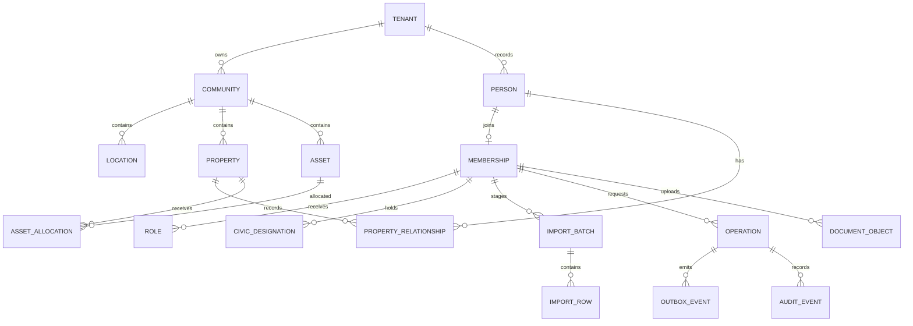

# Domain model and invariants

The migration creates 17 private `app` tables. All IDs are UUIDs independent of human labels, and every association-owned reference is scoped by tenant. The same code/label can be reused by another association; canonical codes are unique inside their documented community/tenant scope. Code strings are case-sensitive identifiers; the S03 import/UI must define normalization and duplicate review before onboarding. Labels can repeat between towers or blocks.

| Group | Tables and purpose |
| --- | --- |
| Community and physical structure | tenants, communities, locations, properties, assets |
| People and entitlement records | people, memberships, membership_roles, civic_designations, property_relationships, asset_allocations |
| Import staging | import_batches, import_rows; raw JSON is untrusted input, not authority |
| Command and event infrastructure | operation_requests, outbox_events, audit_events |
| Private evidence metadata | document_objects; no public URL or live bucket is created |

## Validated constraints
- Composite foreign keys bind children to the same tenant and, where applicable, the same community. Auth users are intentionally global external identities; linking one does not grant access.
- Village locations use optional phase then block; a condominium uses tower then floor. A floor must have a tower. A location parent cannot be changed and must already exist. Property kinds match the community form. Unlocated properties can be staged; activation validation belongs to S03.
- Tenant IDs and internal IDs cannot be changed; community IDs on community-owned rows and community form are immutable. Ownership transfer creates/ends effective-dated relationships, never moves records to another HOA.
- Membership, role, designation, ownership/tenancy/representation and allocation windows require end greater than start. Windows are half-open. Status, dates and active permission policies must all be evaluated by S02 services; dates alone grant nothing.
- Exact area/share fields reject invalid ranges and NaN. Property shares are fractions above zero through one. Aggregate ownership totals, fine allocation and money rounding are future finance rules.
- Document paths are computed as tenant ID/object ID. Tenant and object identity cannot be reassigned; object paths are generated and not writable. Scan state begins pending; metadata is not proof of a scanned/uploaded file.
- Imports and operations have tenant-scoped unique idempotency keys. Outbox sequence is unique per operation. Import rows are unique per batch/row number. Invalid dates, actor references and mismatched tenant references fail in SQL.
- Audit events reject update/delete, including ordinary owner-issued DML. A superuser can still alter triggers/schema; restricted application roles and external audit retention are required before production.

## Deliberately incomplete business enforcement
No entitlement policies, login binding workflow, import commit/approval service, ledger, worker, bucket, booking engine or parking-capacity service is enabled. Overlapping tenancy/primary contacts, membership renewal history, exclusive asset allocations and concurrent resource reservations must be resolved transactionally by their owning S02/S03/S09 workflows. The current staging schema must not be opened as a generic CRUD API.

Fixtures cover two associations, phase/block lots, tower/floor units, parking/storage, a person owning multiple properties, coowners, a tenant, a corporate owner with a representative, and the same staff principal with explicit memberships in both associations. Civic president status remains separate from resident system access.
